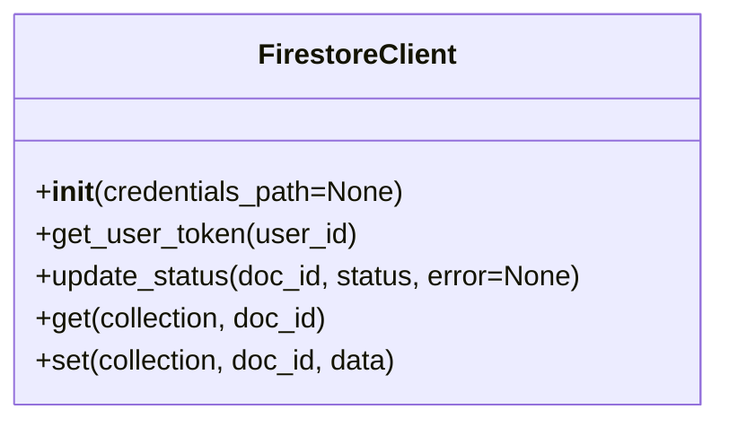

# Firestore Client

## Overview
This client provides a modular interface for interacting with Google Firestore from the backend. It handles user data, ingestion status, and other persistent storage needs.

## Class Diagram


## Methods
- **`__init__(credentials_path=None)`**: Loads Firestore credentials from the argument or the `GOOGLE_APPLICATION_CREDENTIALS` environment variable. Uses default credentials if not set.
- **`get_user_token(user_id)`**: Fetches a user's Google OAuth access token from the `users` collection.
- **`update_status(doc_id, status, error=None)`**: Updates the ingestion status and error details for a document in the `ingestion_status` collection.
- **`get(collection, doc_id)`**: Generic get for any collection/document.
- **`set(collection, doc_id, data)`**: Generic set for any collection/document.

## Usage in Backend
Import and use the client in your service or worker:
```python
from clients.firestore.firestore_client import FirestoreClient

db = FirestoreClient()
token = db.get_user_token("user123")
db.update_status("doc456", "success")
```

## Running Online (GCP Setup)
- Enable Firestore in your Google Cloud project.
- Deploy your backend to GCP (Cloud Run, Cloud Functions, etc.).
- Grant the service account the `roles/datastore.user` permission.
- Locally, authenticate with `gcloud auth application-default login` or set the `GOOGLE_APPLICATION_CREDENTIALS` env var to your service account key.

## Secrets & API Key Handling
- **Never hardcode credentials.**
- The client loads credentials from the environment or can be extended to use Secret Manager.
- Example (local):
  ```bash
  export GOOGLE_APPLICATION_CREDENTIALS=/path/to/service-account.json
  ```
- Example (GCP):
  - Store secrets in Secret Manager and grant access to your service account.

## Extending
- Add new methods for other Firestore operations as needed.
- Replace the placeholder error handling/logging with your preferred logging framework.
