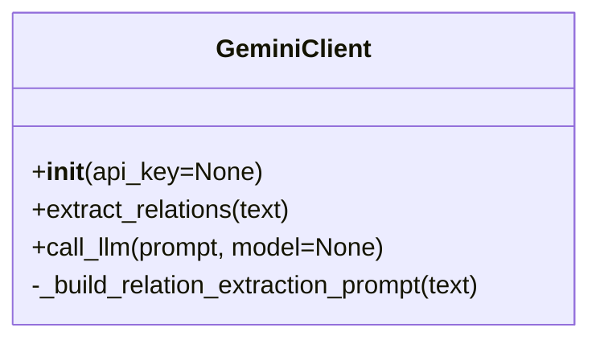

# Gemini Client

## Overview
This client provides a modular interface for interacting with the Gemini LLM API from the backend. It is used for prompt engineering, relation extraction, and other LLM-powered tasks.

## Class Diagram


## Methods
- **`__init__(api_key=None)`**: Loads the Gemini API key from the argument or the `GEMINI_API_KEY` environment variable. Raises an error if not set. Sets the base URL from `GEMINI_API_URL` or defaults to a placeholder.
- **`extract_relations(text)`**: Builds a prompt and calls the LLM to extract entities and relationships from the given text. Returns a list of relation dicts.
- **`call_llm(prompt, model=None)`**: Makes a generic call to the Gemini LLM API with the given prompt and optional model. Returns the raw API response (mocked for now).
- **`_build_relation_extraction_prompt(text)`**: Internal helper to build a prompt for relation extraction.

## Usage in Backend
Import and use the client in your service or worker:
```python
from clients.gemini.gemini_client import GeminiClient

gemini = GeminiClient()
relations = gemini.extract_relations("Some text chunk")
```

## Running Online (API Key Setup)
- Obtain a Gemini API key from your provider (e.g., Google AI Studio).
- Set the API key as an environment variable (e.g., `GEMINI_API_KEY`).
- Optionally set `GEMINI_API_URL` if using a custom endpoint.
- Deploy your backend to your cloud provider.

## Secrets & API Key Handling
- **Never hardcode API keys.**
- The client loads the API key from the environment or can be extended to use Secret Manager.
- Example (local):
  ```bash
  export GEMINI_API_KEY=your-key-here
  ```
- Example (GCP):
  - Store the API key in Secret Manager and grant access to your service account.

## Extending
- Add new methods for other LLM tasks as needed.
- Replace the placeholder API call logic in `call_llm` with real Gemini API integration.
