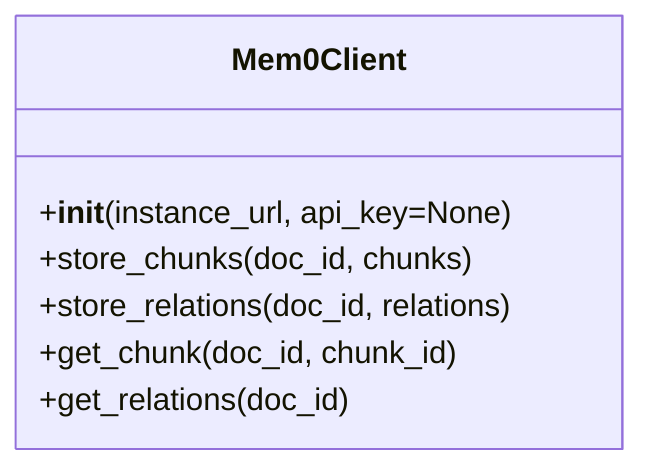

# Mem0 Client

## Overview
This client provides a modular interface for interacting with Mem0 memory instances (content and relations) from the backend. Each instance of the client is configured for a specific Mem0 instance, making it easy to manage multiple sources (e.g., Google Docs, Slack, Relations).

## Class Diagram


## Multi-Instance Pattern
- Create a separate Mem0Client for each Mem0 instance (e.g., GDocs, Slack, Relations).
- Each client is stateless and reusable.

## Methods
- **`__init__(instance_url, api_key=None)`**: Configures the client for a specific Mem0 instance. Loads API key from argument or `MEM0_API_KEY` env var.
- **`store_chunks(doc_id, chunks)`**: Stores content chunks for a document.
- **`store_relations(doc_id, relations)`**: Stores relations for a document.
- **`get_chunk(doc_id, chunk_id)`**: Retrieves a specific chunk.
- **`get_relations(doc_id)`**: Retrieves all relations for a document.

## Usage in Backend
```python
from clients.mem0.mem0_client import Mem0Client

gdocs_mem0 = Mem0Client(instance_url="https://mem0-gdocs.example.com", api_key="gdocs-key")
relations_mem0 = Mem0Client(instance_url="https://mem0-relations.example.com", api_key="relations-key")

gdocs_mem0.store_chunks("doc123", ["chunk1", "chunk2"])
relations_mem0.store_relations("doc123", [{"entity": "foo"}])
```

## Managing Multiple Instances
- Store each Mem0 instance's URL and API key in environment variables or Secret Manager.
- Instantiate a Mem0Client for each required instance at runtime.

## Secrets & API Key Handling
- **Never hardcode API keys.**
- The client loads the API key from the environment or can be extended to use Secret Manager.
- Example (local):
  ```bash
  export MEM0_API_KEY=your-key-here
  ```
- Example (GCP):
  - Store the API key in Secret Manager and grant access to your service account.

## Extending
- Add new methods for other Mem0 operations as needed.
- Replace the placeholder API call logic with real Mem0 API integration.
