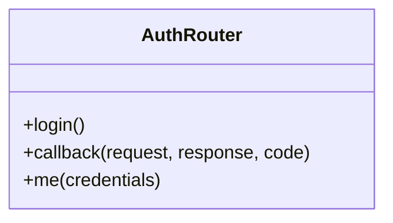

# Router Layer: Class Design

## AuthRouter

### Method Descriptions
- **login()**
  - Redirects the user to Google's OAuth 2.0 authorization endpoint.
- **callback(request, response, code)**
  - Handles the OAuth callback, exchanges code for tokens, verifies the ID token, stores user info, and issues a JWT.
- **me(credentials)**
  - Returns the current authenticated user's info by decoding the JWT from the Authorization header.
