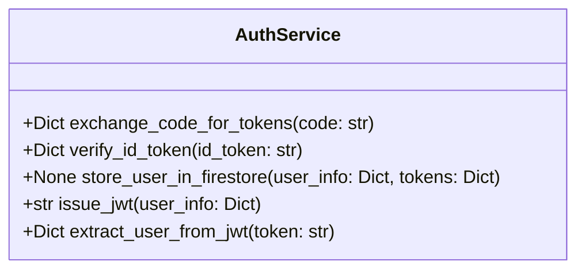

# AuthService: Class Design

### Method Descriptions
- **exchange_code_for_tokens(code: str) -> Dict**
  - Exchanges an OAuth authorization code for Google tokens (id_token, access_token, refresh_token).
- **verify_id_token(id_token: str) -> Dict**
  - Verifies the Google ID token and extracts user information (sub, email, name, etc).
- **store_user_in_firestore(user_info: Dict, tokens: Dict) -> None**
  - Stores or updates the user profile and tokens in Firestore.
- **issue_jwt(user_info: Dict) -> str**
  - Issues a signed JWT for the authenticated user, containing user claims and expiry.
- **extract_user_from_jwt(token: str) -> Dict**
  - Decodes and validates a JWT, returning the user claims if valid.
