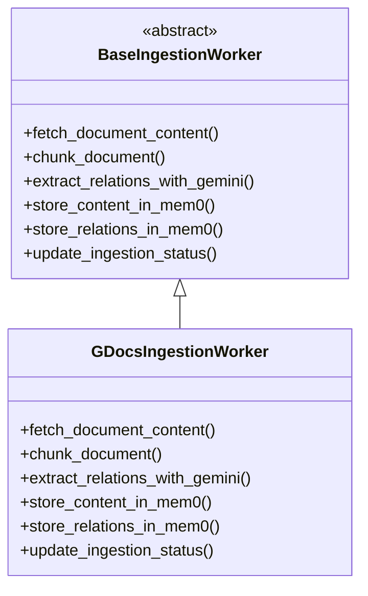

# Google Docs Ingestion Service

## Overview
This service handles ingestion of Google Docs into the UniversalChat memory architecture. It fetches, chunks, analyzes, and stores Google Docs content and relations in the appropriate Mem0 instances.

## Coding Structure
- **Directory:** `backend/services/gdocs/`
- **Base Class:** Inherits from `BaseIngestionWorker` (defined in the ingestion module)
- **Subclass:** `GDocsIngestionWorker` implements Google Docs-specific logic
- **Mem0 Clients:**
  - `gdocs_mem0_client` for content
  - `relations_mem0_client` for relations

## SOLID Principles
- **Single Responsibility:** Only handles Google Docs ingestion logic.
- **Open/Closed:** New sources (e.g., Slack) can be added by subclassing the base.
- **Liskov Substitution:** Can be used wherever a BaseIngestionWorker is expected.
- **Interface Segregation:** Only implements relevant methods for Google Docs.
- **Dependency Inversion:** High-level orchestration depends on the abstract base, not this concrete class.

## Class Diagram

## Extending
To add a new source, create a new directory and subclass `BaseIngestionWorker` with source-specific logic.
