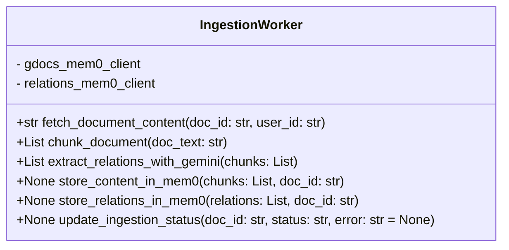

# Ingestion Service: Class Design

### Mem0 Clients
- **gdocs_mem0_client:** Handles storage of Google Docs content chunks.
- **relations_mem0_client:** Handles storage of extracted relations.

### Method Descriptions
- **fetch_document_content(doc_id: str, user_id: str) -> str**
  - Fetches the raw text of a Google Doc using the user's credentials.
- **chunk_document(doc_text: str) -> List**
  - Splits the document text into manageable chunks for processing.
- **extract_relations_with_gemini(chunks: List) -> List**
  - Calls the Gemini API to extract entities and relationships from each chunk.
- **store_content_in_mem0(chunks: List, doc_id: str) -> None**
  - Stores the content chunks in the Google Docs Mem0 content memory instance using `gdocs_mem0_client`.
- **store_relations_in_mem0(relations: List, doc_id: str) -> None**
  - Stores the extracted relations in the central Mem0 relations memory instance using `relations_mem0_client`.
- **update_ingestion_status(doc_id: str, status: str, error: str = None) -> None**
  - Updates the ingestion status and error details in Firestore for observability.
