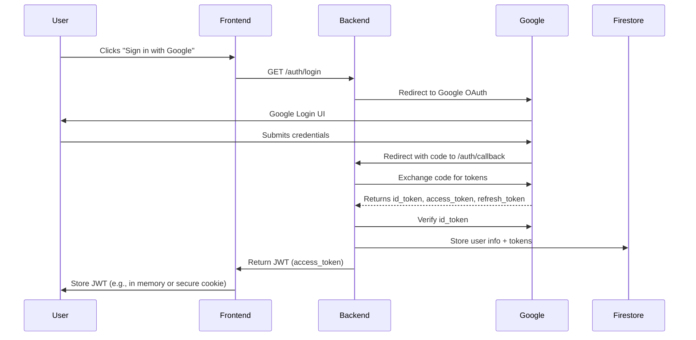

# Architecture Documentation

This file will contain detailed architecture diagrams and explanations for UniversalChat.

---

## Low Level Design: Backend Authentication (Google OAuth + JWT)

### 1. OAuth Flow Sequence

### 2. JWT/Session Handling
- Backend issues a signed JWT (HS256) containing user id, email, name, and expiry (1 hour).
- JWT is returned to the frontend after successful login.
- Frontend includes JWT in Authorization header for all API requests.
- Backend validates JWT on each request to protected endpoints.

### 3. Firestore User Model
- Collection: `users/{user_id}`
- Document fields:
  - `email`: string
  - `name`: string
  - `picture`: string
  - `tokens`: object (id_token, access_token, refresh_token, expiry)
  - `updated_at`: timestamp

### 4. Security Considerations
- All secrets (Google client secret, JWT secret) stored in Secret Manager or environment variables.
- JWT expiry enforced (1 hour, refresh via re-login or refresh token flow).
- HTTPS enforced for all endpoints.
- No Google tokens are sent to the frontend; only the backend stores them.
- JWT is signed and verified using a strong secret.

### 5. API Endpoint Contract

| Endpoint         | Method | Request Params         | Response                        | Auth Required |
|------------------|--------|-----------------------|----------------------------------|--------------|
| /auth/login      | GET    | -                     | Redirect to Google OAuth         | No           |
| /auth/callback   | GET    | code (query param)    | { access_token: JWT, ... }       | No           |
| /auth/me         | GET    | Authorization: Bearer | { user: { id, email, name, ...}} | Yes (JWT)    |

---

*Review and confirm this LLD before code implementation.*
