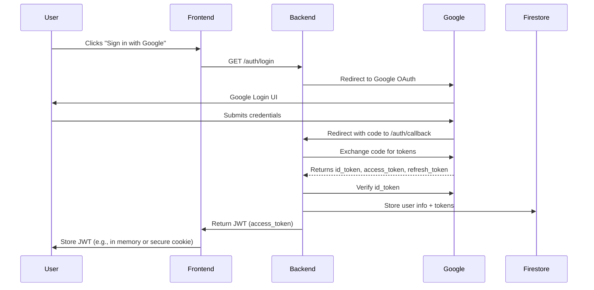
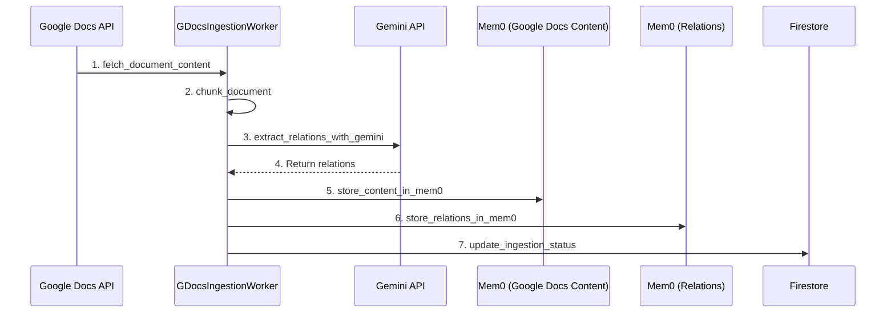

# Architecture Documentation

This file will contain detailed architecture diagrams and explanations for UniversalChat.

---

## Low Level Design: Backend Authentication (Google OAuth + JWT)

### 1. OAuth Flow Sequence

### 2. JWT/Session Handling
- Backend issues a signed JWT (HS256) containing user id, email, name, and expiry (1 hour).
- JWT is returned to the frontend after successful login.
- Frontend includes JWT in Authorization header for all API requests.
- Backend validates JWT on each request to protected endpoints.

### 3. Firestore User Model
- Collection: `users/{user_id}`
- Document fields:
  - `email`: string
  - `name`: string
  - `picture`: string
  - `tokens`: object (id_token, access_token, refresh_token, expiry)
  - `updated_at`: timestamp

### 4. Security Considerations
- All secrets (Google client secret, JWT secret) stored in Secret Manager or environment variables.
- JWT expiry enforced (1 hour, refresh via re-login or refresh token flow).
- HTTPS enforced for all endpoints.
- No Google tokens are sent to the frontend; only the backend stores them.
- JWT is signed and verified using a strong secret.

### 5. API Endpoint Contract

| Endpoint         | Method | Request Params         | Response                        | Auth Required |
|------------------|--------|-----------------------|----------------------------------|--------------|
| /auth/login      | GET    | -                     | Redirect to Google OAuth         | No           |
| /auth/callback   | GET    | code (query param)    | { access_token: JWT, ... }       | No           |
| /auth/me         | GET    | Authorization: Bearer | { user: { id, email, name, ...}} | Yes (JWT)    |

---

*Review and confirm this LLD before code implementation.*

---

## Low Level Design: Data Ingestion Pipeline

### 1. Ingestion Class Hierarchy

- **BaseIngestionWorker (abstract):** Defines the skeleton for all ingestion workers (fetch, chunk, extract, store, update status).
- **GDocsIngestionWorker:** Inherits from BaseIngestionWorker, implements Google Docs-specific logic.
- **SlackIngestionWorker (future):** Inherits from BaseIngestionWorker, implements Slack-specific logic.

This design follows SOLID principles for extensibility and maintainability.

### 2. Ingestion Flow Sequence Diagram

### 3. Modularity & SOLID Principles
- **Single Responsibility:** Each worker class handles only its source-specific logic.
- **Open/Closed:** New sources can be added by subclassing without modifying the base.
- **Liskov Substitution:** All workers can be used interchangeably where the base is expected.
- **Interface Segregation:** Only relevant methods are implemented per subclass.
- **Dependency Inversion:** High-level logic depends on the abstract base, not concrete implementations.

### 4. Mem0 Storage Pattern
- Each worker maintains two Mem0 clients:
  - One for the application-specific content memory instance.
  - One for the central relations memory instance.

### 5. API Contract (if triggered via HTTP)
| Endpoint                | Method | Request Body                | Response                  | Auth Required |
|-------------------------|--------|-----------------------------|---------------------------|---------------|
| /ingest/gdocs           | POST   | { doc_id: str, user_id: str } | { status: "ok"/"error" } | Yes (JWT)     |

---

*Review and confirm this LLD before code implementation.*
